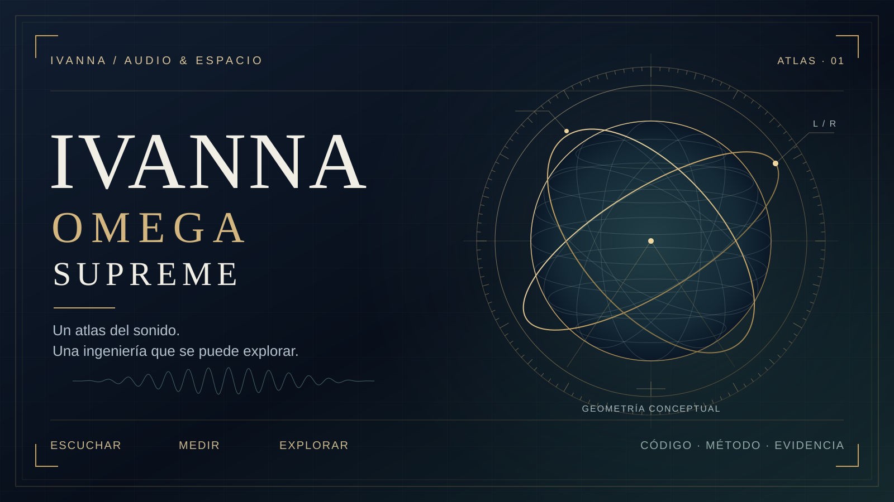

# IVANNA

**Escucha la música como si estuvieras ahí.**

## ¿Qué es IVANNA?

IVANNA es una aplicación de audio para Android que hace que tu música suene como si estuvieras dentro de un espacio real: el sonido te rodea en 360°, se siente vivo y se adapta a ti y a tu habitación.

## ¿Para qué sirve?

Para que la música que ya tienes suene mejor: más real, más clara y con el espacio que se siente en una sala de verdad. No necesitas audífonos caros ni equipo especial: funciona con tu teléfono y con lo que ya usas para escuchar música.

## ¿En qué teléfonos funciona?

En cualquier Android 13 o más nuevo.

## ¿Cómo la consigo?

Descarga la última versión aquí:

👉 **[Descargar IVANNA — última versión](https://github.com/ivanna-omega/IVANNA-OMEGA-SUPREME/releases/latest)**

---

## In English

**IVANNA** is an audio app for Android that makes your music sound like you are inside a real space: sound surrounds you in 360°, feels alive, and adapts to you and your room. No expensive headphones or special equipment needed. Works on any Android 13 or newer.

👉 **[Download IVANNA — latest release](https://github.com/ivanna-omega/IVANNA-OMEGA-SUPREME/releases/latest)**

---

© 2026 Luis Uriel Pimentel Pérez. Todos los derechos reservados.
